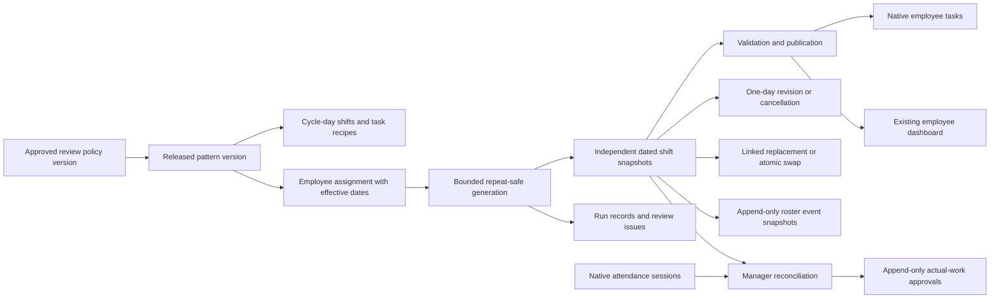

# ADC HRMS roster planning architecture

Decision: extend the existing Odoo 19 scheduling module with a separate
`binaryaid_roster_planning` add-on. The existing shift remains the operational
record and the dashboard remains its employee-facing read model. No second
calendar or competing task system is introduced.

## Approaches evaluated

| Approach | Strength | Limitation in this project | Decision |
| --- | --- | --- | --- |
| Copy yesterday / repeat a shift | Small implementation | Weak effective dates, duplicates, exceptions and ownership history | Reject as the primary model |
| Employee working calendars (`resource.calendar`) | Contractual availability, leave/attendance calculations | Not a dated roster with publication, tasks and exception provenance | Keep native calendars for their existing purpose |
| Native Odoo Planning | Product-managed scheduling, templates and recurrence | Planning is absent from the supplied source/install; adopting it needs a separate product/licensing and migration decision | Re-evaluate if the client adopts Planning; do not add a parallel live roster |
| Pattern + effective assignment + materialized shifts | Fits the existing community-source modules and employee task workflow | Requires maintained generation, validation and audit logic | Selected |

[Odoo Planning documentation](https://www.odoo.com/documentation/19.0/applications/services/planning.html)
describes native shift templates and recurrence. The decision here is based on
the supplied application's architecture, not a claim that a custom module always
outperforms Odoo Planning or a specialist workforce product.

## Domain model

- **Review policy:** explicit reference, employment type and configurable review
  thresholds. Draft → Approved. Approved versions are immutable. No award is
  seeded because the client has not specified its industry or industrial instrument.
- **Pattern:** timezone, 1–12 week cycle, Monday anchor, department, policy,
  cycle-day shift definitions, locations, break/instruction text, common task
  titles and per-shift task recipes. A Mon–Fri starter and readable cycle-day
  labels reduce setup effort.
  Draft → Released → Retired. Released patterns cannot change. New Version
  duplicates the pattern to a draft and links the predecessor. Retired patterns
  cannot receive new assignments; existing assignments remain reproducible.
- **Assignment:** one employee, one pattern version, an employee/group-specific
  policy override (or the pattern default), inclusive local start-date
  period, rolling generation horizon and optional automatic publication. Bulk
  assignment creates these records for a selected employee group in one action.
  An optional per-assignment phase offset supports staggered teams using the
  same rotation. One primary assignment may cover a given employee/date; split shifts belong in
  that pattern. Employees share the anchor unless explicitly phase-offset; assigning someone later does not
  restart everyone else's rotation.
- **Shift:** concrete UTC start/end, original employee, local occurrence date,
  source assignment/line/run, instructions, task recipes and policy snapshot.
  Generated data is independent of future versions. Existing manual shifts remain
  supported. A changed or cancelled occurrence keeps its unique source key.
- **Tasks:** reusable definitions are not employee work items. Publication creates
  fresh native employee tasks for that employee and local start date. Repeated
  publication reuses the materialized tasks. Cancellation archives only the tasks
  generated by that shift; manually linked tasks are not archived. Existing daily
  notes and completion history stay in Work Management.
- **Roster events:** company, employee/login at recording time, author, timestamp,
  reason and a shift snapshot. Normal administrators cannot write/delete these
  events or create forged events through RPC.
- **Actual-work approval:** snapshots selected closed native attendance sessions
  and their native `worked_hours`. It is separate from the original plan. Later
  corrections and reversals append new approvals; the latest determines the
  displayed actual hours. Native attendance changes do not rewrite approvals.

## Complete workflow

1. HR identifies applicable employee terms and approves review policy versions.
2. A scheduler configures a pattern once, including its rotation and task recipes,
   and releases it. Multiple shifts on a cycle day allow split shifts.
3. Assign Employees selects a department/group, effective period and horizon
   (default 56 days). One action activates the per-employee assignment records.
   Overlapping assignment periods fail as a batch; they are never silently ended.
4. Generate Preview selects assignments and dates, shows an upper-bound estimate,
   then creates concrete drafts and a run report. Run → Review Generated Shifts
   opens the resulting occurrences. Managers can select drafts and use
   Actions → Review and Publish, supplying genuine review/consultation evidence.
5. An hourly scheduled action extends active assignments' rolling horizons.
   Generation is automatic; publication defaults to manual. Opt-in automatic
   publication requires an approved policy and passes **without review overrides**.
   A publication failure retains the draft and logs the reason for human review.
6. A one-day change uses the existing Revise action and a reason. It changes only
   that shift and is flagged as an employee-specific exception. The engine cannot
   overwrite it. Past shifts stay fixed; use actual-work corrections instead.
7. Replace / Swap checks future published shifts, employee/company, receiving
   policy, time off and conflicts. It cancels original records and creates linked
   replacements with fresh employee tasks, then publishes them atomically.
   Any failure rolls back both sides. No existing task is reassigned to another
   employee. Required consultation/consent remains a manager responsibility.
8. To change a recurring schedule in the future, end the old assignment with a
   reason and an inclusive last date, then bulk-assign the new version from the
   following day. Later generated source shifts are cancelled, not deleted.
   A future end date continues generation through that end date. Coverage records
   are independent exceptions and must be reviewed if a source assignment changes.
9. Employees use the existing weekly dashboard/calendar. It shows only their
   published shifts, times, planned hours, break duration, locations and tasks.
   The full calendar navigates upcoming weeks; revisions/cancellations notify
   employees through normal Odoo notifications.
10. After a shift finishes, an authorized attendance officer reconciles closed
    attendance sessions. One session can contribute to only one current shift
    approval. Full sessions are used; split a session in native Attendance before
    allocating it across multiple shifts. No second break deduction is applied.

## Generation, concurrency and recovery

The database unique key `(assignment, pattern line, local occurrence date)` is the
last line of defence against duplicates. Assignment locks and employee roster
version writes serialize activation/publication and invalidate stale PostgreSQL
snapshots. Generation reads existing occurrence keys in a bounded date range.
Cancelled shifts are tombstones, not missing work to regenerate. Manual shifts
and existing drafts/published shifts are checked for overlapping windows before
new occurrences are created. Missing failed occurrences can be retried by rerun;
existing publication failures require review rather than silent republication.

UTC is storage, while pattern times are local wall-clock minutes. DST ambiguous
or nonexistent endpoints create issues instead of guessing. Elapsed shift hours
can differ from wall-clock hours on DST transition days. An end at midnight uses
00:00 with Next day. Cycles are checked for overlaps including the cycle wrap.

Manual generation is limited to 100 assignments, 366 days and an upper bound of
10,000 occurrences per call. Larger workforces use multiple batches. The cron
processes up to 100 assignments per invocation, ordered by last update for fair
rotation, and uses Odoo cron progress commits between assignments. Each generation
failure is isolated with a savepoint. Unexpected cron errors are logged and
create an activity for the assignment's creator. Review expected conflicts in
Generation Runs. Cron runs under the configured user's permitted companies;
that service user needs Work Management Administrator and appropriate companies.

This is bounded automation, not a demand/skills optimiser. Large-client throughput
and concurrent-user SLAs must be benchmarked on that client's infrastructure.
A queue-worker implementation can replace the cron orchestrator without changing
patterns, assignments, occurrence keys or employee-visible shift records.

## Permissions and integration boundaries

Work Management Administrator manages patterns, assignments, generation, swaps
and review. This is the project's existing company-wide HR work role; departmental
menu filters are not a new department security boundary. Native Attendance write
access is additionally required to approve actual sessions. Do not broaden all
employee directory or attendance permissions merely to make roster screens work.

Template, assignment, run, issue and policy models use company record rules and
manager-only ACLs. Employees read only their own shift events/actual approvals,
using the login recorded at event time and current shift ownership, after
publication/cancellation. Draft audit snapshots are not employee-visible. Engine provenance is guarded server-side
with a non-serializable private token; RPC context flags cannot forge it. Event
creation alone uses elevation after shift access checks. Private eligibility
checks use narrow elevated boolean lookups for approved leave/calendar holidays;
no absence reasons or other employees' records are returned to users.

Dependencies are the existing scheduling/dashboard/work modules plus native
Attendance and Time Off. There is no core patch, paid add-on dependency, public
API endpoint, external service, payroll import or automatic payslip change.
Native `resource.calendar` and Attendance overtime calculations are not replaced
by roster patterns. Do not treat native overtime or roster review thresholds as
award-derived payable overtime.

Append-only application records are not a certified tamper-proof archive against
database owners. Secure backups, access reviews, retention/export policy,
restoration exercises and operational monitoring remain necessary. Uninstalling
this add-on removes its module-owned data; retain required records first.

## Australian controls and boundaries

Research checked 17 October 2026 using official sources:

- [Maximum weekly hours, Fair Work](https://www.fairwork.gov.au/tools-and-resources/fact-sheets/minimum-workplace-entitlements/maximum-weekly-hours):
  full-time baseline 38 hours; for other employees generally the lesser of 38 and
  usual weekly hours, plus reasonable additional hours. Averaging and reasonable
  additional hours require the actual employment terms/circumstances.
- [Rosters, Fair Work](https://www.fairwork.gov.au/employment-conditions/hours-of-work-breaks-and-rosters/rosters)
  and [consultation, FWC](https://www.fwc.gov.au/consultation-term): regular roster
  changes require applicable consultation; notice and consent terms vary. No
  universal seven-day notice or ten-hour rest rule is hardcoded.
- [Record keeping, Fair Work](https://www.fairwork.gov.au/pay-and-wages/paying-wages/record-keeping):
  time/wage records generally require seven-year retention and controlled
  corrections. Plans, actual attendance and payroll evidence must remain distinct.
- [Fatigue controls, Safe Work Australia](https://www.safeworkaustralia.gov.au/safety-topic/hazards/fatigue/managing-risks):
  safe rostering includes shift design, rest, breaks and consultation. Software
  thresholds do not replace a workplace fatigue risk assessment.

Implemented review gates: weekly start-week planned hours, rest between adjacent
published shifts, publication notice, maximum elapsed shift duration, minimum
paid engagement, unpaid break duration and configured calendar holidays. Approved
employee leave blocks publication. Full-day leave also checks local calendar
dates, so daytime native calendars cannot accidentally allow a night shift on
an approved full day of absence. Zero disables a configured threshold. These
are review aids, not a statutory compliance determination. Break timing and paid
rest breaks remain explicit instructions, not a minute-by-minute fatigue engine.

Before award-specific production use, confirm national/state system coverage,
industry, award/enterprise agreement, classifications, employment types, usual
hours, agreed part-time patterns, jurisdiction/public holidays, qualifications,
availability, roster consultation/consent process and payroll provider. No automatic
penalty rates, overtime pay, allowances, averaging-cycle interpretation, payroll
export, right-to-disconnect messaging policy or legal compliance certification is
claimed. A specialist award/payroll engine should consume approved actuals through
an explicit versioned integration after those inputs are known.

Employees sharing shift times can use the same pattern with different approved
assignment policies (for example full-time and casual cohorts). Do not duplicate
the hours pattern just to change review thresholds. Native employee working
calendars/timezones must also be configured correctly for leave and attendance;
this add-on deliberately does not rewrite contractual calendars. Approved leave
is checked at publication, not continuously polled. Leave approved after a roster
is published requires the manager's normal coverage/change process.

Notification emails are queued until transaction commit for publication, generated
task creation and coverage transitions, so a rolled-back swap does not send an
immediate email for an operation that did not complete. Generation run status
reports what happened in that run; it is an immutable report, not a continuously
recomputed unresolved-issue count. Failed publication drafts are reviewed and
published explicitly.

Existing shifts are not retrospectively attached to patterns, and historical
events are not invented. New roster event snapshots begin when this add-on is
installed; existing Work Management and chatter history remain available.
